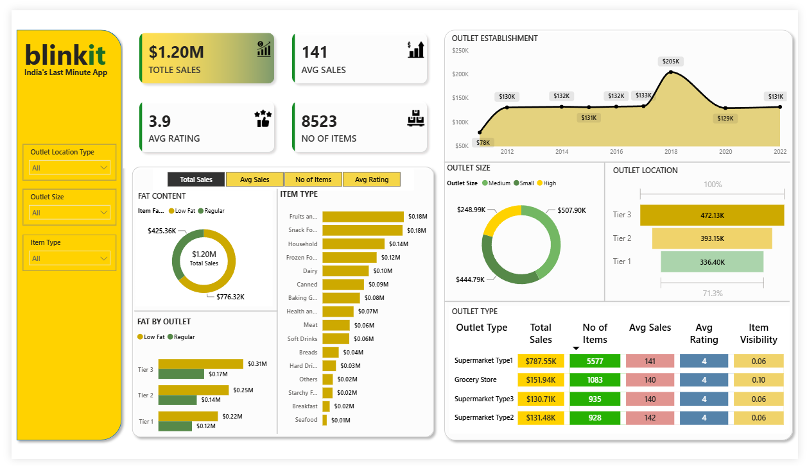

# 🛒 Blinkit Sales & Outlet Analysis Dashboard

An interactive Power BI dashboard designed to analyze the sales performance, outlet establishment trends, and product visibility for **Blinkit** (India's Last Minute App). 

## 📌 Project Overview
This dashboard provides a comprehensive view of Blinkit's sales operations. It helps stakeholders understand which outlet types perform best, how sales have grown over the years, and how product attributes (like fat content and item type) contribute to overall revenue.

## 📊 Dashboard Preview

*(Tip: Replace `Insert_Your_Image_Link_Here.png` with the actual link after you upload your dashboard image to GitHub)*

## 🚀 Key Features & Visuals

### 1. Key Performance Indicators (KPIs)
- **Total Sales:** $1.20M
- **Average Sales per Item:** 141
- **Average Customer Rating:** 3.9
- **Total Unique Items:** 8,523

### 2. Interactive Filters (Slicers)
- **Outlet Location Type:** Filter by Tier 1, Tier 2, or Tier 3 cities.
- **Outlet Size:** Filter by High, Medium, or Small outlets.
- **Item Type:** Filter by specific product categories (e.g., Dairy, Snacks, Household).

### 3. Visualizations Breakdown
- **Outlet Establishment (Line Chart):** Tracks the total sales revenue generated by outlets based on the year they were established (2012–2022).
- **Fat Content (Donut Chart):** Compares the sales contribution of Low Fat vs. Regular products.
- **Item Type (Bar Chart):** Ranks product categories (Fruits, Snacks, Household, etc.) by total sales revenue.
- **Outlet Size & Location (Donut & Bar Charts):** Shows the revenue split by outlet size (Medium, Small, High) and Location Tier.
- **Fat by Outlet (Stacked Bar Chart):** Analyzes the Fat Content preference across different city Tiers.
- **Outlet Type Matrix (Table):** A detailed breakdown of Total Sales, Number of Items, Avg Sales, Avg Rating, and Item Visibility categorized by Supermarket and Grocery Store types.

## 🛠️ Tech Stack Used
- **Power BI Desktop:** For data modeling, DAX measures, and UI/UX design.
- **Data Cleaning (Power Query):** Handled missing values, standardized Item Fat Content labels (e.g., changing "LF" to "Low Fat"), and formatted data types.
- **DAX (Data Analysis Expressions):** Created dynamic measures for KPIs and Average Sales.

## 📂 How to Use This Repository
1. Download the `.pbix` file from this repository.
2. Open it using **Power BI Desktop**.
3. Use the slicers on the left panel to dynamically filter the entire dashboard by Outlet Location, Size, or Item Type.
4. Hover over the visuals to see detailed tooltips.

## 📈 Key Business Insights Derived
- **Top Selling Categories:** Fruits and Snacks are the highest revenue-generating item types.
- **Location Dominance:** Tier 3 cities contribute the highest sales ($472.13K), followed by Tier 2 and Tier 1.
- **Outlet Performance:** Supermarket Type 1 is the most profitable outlet type, generating over $787K in sales.
- **Customer Preference:** Low Fat products have a higher sales volume compared to Regular fat products.

## 👨‍💻 Author
**[Yash Khartode]**

---
*Built to demonstrate data visualization and business intelligence capabilities in the retail sector.*
